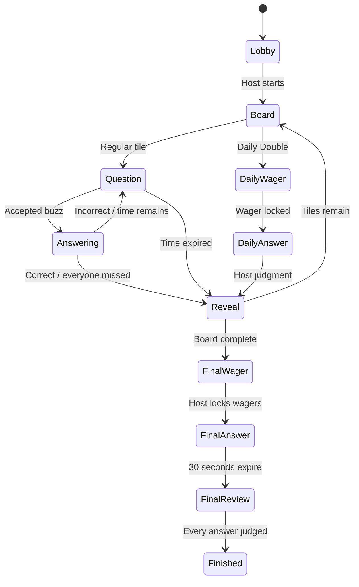

# Architecture

## Trust boundaries

Browsers authenticate using Supabase Auth. Every API request validates the access token with `auth.getUser()`. Hosting requires a non-anonymous account; guests can act only as their own authenticated player identity. The server service-role credential is used only in server modules. Server modules are never imported by client components.

The persisted session contains the frozen board and private answers. Neither browser table reads nor Realtime broadcasts expose that JSON. `viewSession` constructs explicit role-specific projections. A player's private Final answer/wager remains visible only to that player and the host until judged. The host's audience view is sanitized by the server, not merely hidden with CSS.

## Authoritative state and atomic actions

A session is a durable JSON aggregate with an incrementing database `version`. Each command:

1. Authenticates and validates a strict Zod schema.
2. Loads the current aggregate.
3. Reconciles deadlines/host disconnection against server time.
4. Runs the pure state transition with membership, role, phase, controller, wager, and deadline checks.
5. Calls `commit_session(id, expectedVersion, nextState)`.
6. Returns success only after the transaction commits.

The PostgreSQL function conditionally updates the expected version, refreshes session memberships, and broadcasts a version-only notification. If a competing write wins, safe commands reload/retry. A buzzer loser sees the accepted respondent instead of creating another winner. Requests delayed beyond a reopened window cannot buzz because each window has a new UUID.

Host actions also carry a gameplay `actionVersion` to reject stale judgments or phase transitions. Heartbeats advance the persistence version but not the gameplay version, so ordinary liveness writes do not invalidate a host's pending judgment.

Mutating requests carry action UUIDs. Durable processed IDs prevent double scoring on replay. Score events record applied deltas. A separate action history records transitions and corrections without storing PINs or duplicating answer text. Undo restores the immediately preceding judgment snapshot and clears its eligibility after the next accepted buzz/next question.

## Phases

Pause is an independent flag, preserving the underlying phase. Explicit End transitions any unfinished phase to `ended`. Finished/ended sessions are historical records.

## Clocks and disconnects

The server uses epoch-millisecond deadlines. The UI estimates its server clock offset from snapshots and renders a local countdown. The server validates submissions independently of that countdown.

During spoken answers, time is stored as remaining milliseconds. Host loss is effective at `hostSeen + 15 seconds`. Reconciliation first resolves any deadline before that boundary, then pauses. If nobody is connected, reconciliation happens on the next request using the same historical boundary. There is no unreliable process-memory timer or browser `beforeunload` dependency.

Realtime notifications trigger authorized snapshot fetches. A three-second polling fallback, deadline fetch, focus/online listeners, and version checks recover dropped/out-of-order messages. Notifications are best effort: a Realtime outage cannot roll back a committed gameplay action.

## Controller ownership

Each mounted host console gets a fresh controller UUID. Claim requires host account ownership plus the session's hashed six-digit PIN. Claim pauses the session, changes the controller UUID, and refreshes host liveness. The host must select Continue. Old controllers cannot heartbeat or issue host commands. Audience windows never claim control or keep the host alive.

## Rate limiting and limits

Atomic database buckets enforce PIN attempts, joining, saving, commands, and answer writes. Buckets use HMAC-hashed account/IP identifiers. Command/answer IP limits allow multiple phones behind one router; PIN and join attempts retain tighter shared-IP limits. Supabase Auth has its own authentication rate limits; configure its abuse protections for public deployments.

Session JSON is intentionally simple and suitable for casual rooms. For large numbers of players or rooms, split heartbeats, attempts, and score events into normalized tables, measure CAS contention, and introduce a dedicated room coordinator if latency objectives require it. Keep server-authoritative arbitration and durable state even if the transport changes.
