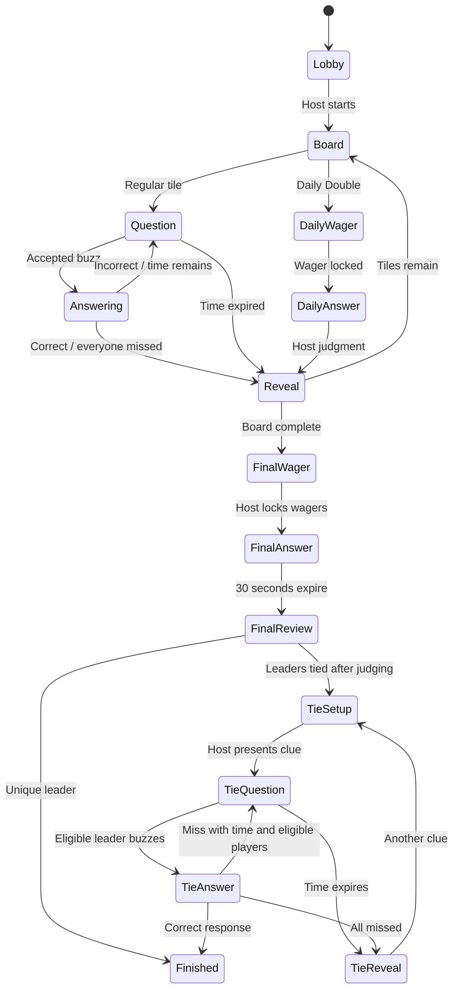

# Architecture

## Trust boundaries

Browsers authenticate using Supabase Auth. Every API request validates the access token with `auth.getUser()`. Hosting requires a non-anonymous account; guests can act only as their own authenticated player identity. The server service-role credential is used only in server modules. Server modules are never imported by client components.

The persisted session contains the frozen board and private answers. Neither browser table reads nor Realtime broadcasts expose that JSON. `viewSession` constructs explicit role-specific projections. A player's private Final answer/wager remains visible only to that player and the host until judged. The host's audience view is sanitized by the server, not merely hidden with CSS.

## Authoritative state and atomic actions

A session is a durable JSON aggregate with an incrementing database `version`. Each command:

1. Authenticates and validates a strict Zod schema.
2. Loads the current aggregate.
3. Reconciles deadlines/host disconnection against server time.
4. Runs the pure state transition with membership, role, phase, controller, wager, and deadline checks.
5. Calls `commit_session(id, expectedVersion, nextState)`.
6. Returns success only after the transaction commits.

The PostgreSQL function conditionally updates the expected version, refreshes session memberships, and broadcasts a version-only notification. If a competing write wins, safe commands reload/retry. A buzzer loser sees the accepted respondent instead of creating another winner. Requests delayed beyond a reopened window cannot buzz because each window has a new UUID.

Host actions also carry a gameplay `actionVersion` to reject stale judgments or phase transitions. Heartbeats advance the persistence version but not the gameplay version, so ordinary liveness writes do not invalidate a host's pending judgment.

Mutating requests carry action UUIDs. Durable processed IDs prevent double scoring on replay. Score events record applied deltas. A separate action history records transitions and corrections without storing PINs or duplicating answer text. Undo restores the immediately preceding judgment snapshot and clears its eligibility after the next accepted buzz/next question.

## Phases

Pause is an independent flag, preserving the underlying phase. Explicit End transitions any unfinished phase to `ended`. Finished/ended sessions are historical records.

## Clocks and disconnects

The server uses epoch-millisecond deadlines. The UI estimates its server clock offset from snapshots and renders a local countdown. The server validates submissions independently of that countdown.

During spoken answers, time is stored as remaining milliseconds. Host loss is effective at `hostSeen + 15 seconds`. Reconciliation first resolves any deadline before that boundary, then pauses. If nobody is connected, reconciliation happens on the next request using the same historical boundary. There is no unreliable process-memory timer or browser `beforeunload` dependency.

Realtime notifications trigger authorized snapshot fetches. A three-second polling fallback, deadline fetch, focus/online listeners, and version checks recover dropped/out-of-order messages. Notifications are best effort: a Realtime outage cannot roll back a committed gameplay action.

## Controller ownership

Each reopened host console gets a fresh controller UUID; a newly launched console consumes its one-use controller handoff instead. Claim requires host account ownership plus the session's hashed six-digit PIN. Claim pauses the session, changes the controller UUID, and refreshes host liveness. The host must select Continue. Old controllers cannot heartbeat or issue host commands. Audience windows never claim control or keep the host alive.

## Rate limiting and limits

Atomic database buckets enforce PIN attempts, joining, saving, commands, and answer writes. Buckets use HMAC-hashed account/IP identifiers. Command/answer IP limits allow multiple phones behind one router; PIN and join attempts retain tighter shared-IP limits. Supabase Auth has its own authentication rate limits; configure its abuse protections for public deployments.

Session JSON is intentionally simple and suitable for casual rooms. For large numbers of players or rooms, split heartbeats, attempts, and score events into normalized tables, measure CAS contention, and introduce a dedicated room coordinator if latency objectives require it. Keep server-authoritative arbitration and durable state even if the transport changes.

## Category-based question JSON

The editor can validate pasted JSON through the authenticated `POST /api/games/import` endpoint. Shared schemas enforce a complete rectangular board, bounded values/text, unique category names, one Daily Double, and Final Jeopardy before conversion to internal question IDs. Validation does not write or start a game; applying the returned board uses the existing version-protected save/autosave path.

Migration `002_question_json.sql` adds stored generated `question_json` columns to saved games and sessions. PostgreSQL builds them from the authoritative board in category/row order, automatically backfilling old records and updating the saved representation after every visual edit or duplication. The session representation derives from its frozen session board. This avoids storing conflicting copies of pasted JSON and manually edited questions. Private answer access remains unchanged; the generated columns are not part of player or audience projections.

## Practice, answer deadlines, dashboard ending, and standings

Practice uses separate `practiceOpen`, `practiceAnswer`, and `practiceReady` phases. Buzzes use the same atomic window arbitration, while score events and board tile consumption remain untouched. Host resets generate a fresh window ID, and Finish Practice returns to the lobby.

An optional `answerLimitSeconds` session setting defaults to zero for backward compatibility. After a normal buzz, `answerDeadline`/`answerRemaining` run independently from the paused question buzzer time. Reconciliation processes answer expiry at the authoritative deadline instant, then processes any subsequent buzzer expiry up to the host-disconnect boundary. A deterministic timeout event ID, cleared deadline, and CAS commit prevent repeat deductions. Pause/claim freeze both clocks. Undo restores the prior respondent and score but leaves further judgment manual.

`POST /api/sessions/:id/end` requires a permanent authenticated host, stored session ownership, an action UUID, and explicit confirmation. Only this route supplies the internal `dashboardEnd` context to bypass PIN/controller/version requirements for the terminal End action. Client command envelopes cannot supply that context; engine ownership checks remain mandatory. Retried terminal ends are no-ops.

Standings use a shared ranking calculation and keyed DOM rows. A layout effect animates each row from its previous offset to its new offset, including pre-question positions on the reveal screen, without changing authoritative ordering or scores. Heartbeat-only refreshes do not restart animation. Reduced-motion preferences disable movement.

## Connection error lifecycle and confetti

`useSession` tracks synchronization errors separately from action/validation errors. A successful authorized snapshot clears synchronization errors and restores the connection indicator without erasing gameplay errors. A monotonically increasing request sequence orders connection outcomes across refresh and command requests, so delayed failures from older requests cannot undo a newer recovery. Focus/online/visible-page listeners work independently of the Realtime subscription, including for read-only hosts.

Final confetti is a client-only canvas overlay with bounded particle count, capped device-pixel ratio, a short animation lifetime, and cleanup of animation frames/listeners on completion or unmount. Session storage prevents repeated bursts on result refresh; reduced-motion preferences suppress it, including when enabled during the animation. The effect is decorative, silent, hidden from assistive technology, and pointer-transparent.

## Launch control handoff and results exports

The launch request carries a validated controller UUID alongside its existing idempotent request ID. After PIN verification, `createSession` includes that controller in the state passed to the atomic `launch_session` transaction. Retries return the existing session ID without changing control or pausing the session. The client hands the UUID to the destination console once using session storage (with an in-memory navigation fallback), consumes/removes it on mount, and waits for controller initialization before fetching host state. Reloads create a fresh UUID and retain the claim/PIN/Continue protection; Strict Mode effect replay retains the same initialized controller. The host PIN is never stored in this handoff.

`GET /api/sessions/:id/results` requires a permanent authenticated host, exact stored host ownership, and a finished/ended phase. It returns a private, noncached CSV attachment built from persisted players, played questions and the surviving score event ledger. Undo removes superseded score events, so exports follow corrected scores rather than replaying the action audit. Questions with no score events still get zero-change summaries; removed players are included without a rank. Event order and cumulative scores are preserved; text cells are quoted and formula-like strings neutralized while numeric negative scores remain numeric. The export does not serialize private state, PIN hashes, answers or unrevealed board questions, and needs no controller claim or database migration.

## Sudden-death state and display scopes

`finish` after complete Final review snapshots the tied active leaders into `tiebreaker.playerIds` and enters `tieSetup` when necessary. Host-authored clues are strictly validated, privately stored in the durable session, and opened through `tieClue`. `buzz` reuses atomic CAS/window arbitration but permits only those leaders and records one attempt per clue. `tieJudge` records an attempt without a ScoreEvent or money change; only a correct judgment sets the persistent winner and `finished`. All misses/time expiry enter `tieReveal`; `tieNext` keeps every original tied leader eligible for the new clue. Host reveal can abandon a clue without declaring a winner. Clue and optional answer clocks freeze on pause/claim and reconcile with the existing host-loss boundary; answer timeout is a miss without a deduction. Resume, CSV, ranking, winner display and confetti honor the saved tiebreaker outcome. Existing terminal sessions remain historical; new ties use sudden death.

`viewSession` omits clue text during regular/tiebreaker answering and excludes private tiebreaker answers from players/audience before reveal. Only the current round is projected; preparing the next clue does not leak previous private round data. No unrevealed tiebreaker answer is broadcast.

Action errors are scoped to phase, question ID, current tiebreaker round and buzzer window. Accepting a newer stage clears errors; late action failures from the old scope are ignored. Successful synchronization of the same stage still preserves applicable validation errors. Projection typography uses responsive sizes and wrapping rather than clipping or shrinking long clues to unreadable text.

## Saved tiebreaker queue

Optional `board.tiebreakers` holds at most 20 category/prompt/answer objects and is copied into each immutable session board. Portable JSON uses `question` in place of `prompt`. Both conversion directions and migration 003's generated-column function preserve this optional key and its order. Old boards without the key remain valid. Draft editor entries can be incomplete, while `playable` and JSON import require complete saved clues. Column resizing preserves the list.

The strict host-only `tieSavedClue` command atomically reads the next frozen clue using `tiebreaker.savedCluesUsed`, advances the counter and opens the existing sudden-death buzzer phase. Retries use the existing action-ID deduplication; stale versions cannot consume extra clues. Custom clues do not advance the saved queue. The consumed position survives pause, takeover and reload. Host projections expose remaining count/next category only, and no future clue content is included in player/audience projections. An exhausted queue rejects another saved launch, exposing custom entry instead of repeating clues. Migration 003 recomputes existing stored JSON values without changing authoritative gameplay/version fields or access policies.

## Wake locks and received Final answers

`KeepAwake` is an opt-in client capability on unfinished host/player sessions. Generation tokens invalidate requests after cancel, visibility loss or unmount, releasing late-granted sentinels. A release listener reports actual ownership; visibility listeners reacquire only while opted in. OS denial/release never mutates authoritative state. Unsupported contexts fall back to device timeout guidance. Browser capability tests use mock sentinels; physical device/power-policy behavior remains browser controlled.

Accepted `answer` commands set optional `FinalEntry.submittedAt` from server context without changing deadline, pause, scoring or judgment rules. The host-only overview derives nonblank counts from the latest authorized snapshot and distinguishes missing from received blank text. Existing records with nonblank text remain recognized. Submission timestamps follow the same private projection boundary as answer text: before judgment only the host and submitting player receive them. No new public count/payload is added to audience projections and no database migration is needed.
